# Modello dati del catalogo

Il catalogo dei balli è salvato in forma **relazionale** su Neon (PostgreSQL).
La tabella storica `line_dance_data`, con l'intero catalogo in un unico JSON, **non è stata modificata**.
Resta come **copia di compatibilità**: ogni salvataggio dall'admin la riscrive nella stessa transazione
delle tabelle relazionali, quindi i client che leggono ancora il JSON
(`/.netlify/functions/dances`, versioni precedenti del sito) continuano a funzionare.

## Diagramma ER

```mermaid
%%{init: {"theme": "base", "themeVariables": {"lineColor": "#f59e0b", "primaryColor": "#e8eefc", "primaryBorderColor": "#5b7fd6", "primaryTextColor": "#111827", "tertiaryColor": "#f8fafc", "fontSize": "14px"}}}%%
erDiagram
    levels ||--o{ dances : "level_id"
    styles ||--o{ dances : "style_id"
    dances ||--o{ dance_choreographers : "dance_id"
    choreographers ||--o{ dance_choreographers : "choreographer_id"
    dances ||--o{ dance_media : "dance_id"
    media_providers ||--o{ dance_media : "provider_code"
    dances ||--o{ dance_properties : "dance_id"
    property_definitions ||--o{ dance_properties : "property_key"
    app_users ||--o{ user_identities : "user_id"
    app_users ||--o{ tags : "user_id"
    tags ||--o{ dance_tags : "tag_id"
    dances ||--o{ dance_tags : "dance_id"
    system_tags ||--o{ dance_system_tags : "tag_id"
    dances ||--o{ dance_system_tags : "dance_id"
    app_users ||--o{ dance_ratings : "user_id"
    dances ||--o{ dance_ratings : "dance_id"
    app_users ||--o{ tag_shares : "from_user_id"
    app_users ||--o{ tag_shares : "to_user_id"

    dances {
        int id PK "stesso id del JSON storico"
        text title
        text song_title
        int level_id FK
        int style_id FK
        text details "solo testo libero non strutturato"
        text notes
        int sort_order "ordine manuale dell'admin"
        int version "incrementata a ogni salvataggio"
        timestamptz created_at
        timestamptz updated_at
    }
    levels {
        serial id PK
        text code UK "beginner, easy_improver, ..."
        text label "Beginner, Easy Improver, ..."
        int sort_order "ordine di difficoltà"
    }
    styles {
        serial id PK
        text name UK "Line, Couple, Contra"
    }
    choreographers {
        serial id PK
        text name UK
    }
    dance_choreographers {
        int dance_id PK,FK
        int choreographer_id PK,FK
        int position "ordine di citazione"
    }
    media_providers {
        text code PK "youtube, spotify, amazon_music, stepsheet"
        text label
        text kind "video | audio | document | link"
        bool has_title
        int sort_order
    }
    dance_media {
        bigserial id PK
        int dance_id FK
        text provider_code FK
        text url
        text title
        int position "ordine per provider"
        int start_seconds "video: inizio"
        int dance_start_seconds "video: parte ballata"
        jsonb extra "configurazione specifica del provider"
    }
    property_definitions {
        text key PK "counts, walls, ..."
        text label "etichetta in admin"
        text details_label "chiave nel testo dettagli (Tempi, Muri, ...)"
        text data_type "text | longtext | number | boolean | url | date"
        int sort_order
        bool is_public
        bool is_filterable
    }
    dance_properties {
        int dance_id PK,FK
        text property_key PK,FK
        jsonb value
    }
    app_users {
        bigserial id PK
        text email UK
        text display_name
        text avatar_url
        text role "user | editor (gli amministratori vengono da ADMIN_EMAILS)"
    }
    user_identities {
        text provider PK "google | facebook | netlify"
        text provider_user_id PK
        bigint user_id FK
    }
    tags {
        bigserial id PK
        bigint user_id FK
        text name "univoco per utente"
        text color
    }
    dance_tags {
        bigint tag_id PK,FK
        int dance_id PK,FK
    }
    system_tags {
        serial id PK
        text name UK "univoco globale"
        text color "hex #rrggbb"
    }
    dance_system_tags {
        int tag_id PK,FK
        int dance_id PK,FK
        int position "ordine sul ballo"
    }
    dance_ratings {
        bigint user_id PK,FK
        int dance_id PK,FK
        smallint stars "0-5"
        timestamptz updated_at
    }
    tag_shares {
        bigserial id PK
        bigint from_user_id FK
        bigint to_user_id FK
        jsonb tags "copia dei tag inviati: nome, colore, balli"
        text message
        text status "pending | accepted | declined"
        int accepted_count "tag accettati"
    }
```



Il diagramma riporta chiavi primarie (PK), esterne (FK), univoche (UK) e cardinalità.
Ogni arco collega la tabella referenziata (lato `||`, "uno") a quella che la referenzia
(lato `o{`, "zero o molti") e porta il nome della colonna di chiave esterna.
I vincoli che la sintassi Mermaid non può rappresentare (CHECK, regole ON DELETE/ON UPDATE,
unicità senza distinzione di maiuscole) sono elencati nella sezione [Vincoli](#vincoli).

## Vincoli

Tutti i vincoli sono applicati dal database, non solo dal codice.

### Chiavi primarie

| Tabella | Chiave |
|---|---|
| `dances` | `id` (lo stesso id del JSON storico, non generato) |
| `levels`, `styles`, `choreographers`, `app_users`, `tags`, `dance_media` | `id` generato |
| `media_providers` | `code` |
| `property_definitions` | `key` |
| `dance_choreographers` | `(dance_id, choreographer_id)`: un coreografo compare una sola volta per ballo |
| `dance_properties` | `(dance_id, property_key)`: una proprietà ha un solo valore per ballo |
| `dance_tags` | `(tag_id, dance_id)`: lo stesso tag non si ripete sullo stesso ballo |
| `system_tags` | `id` generato |
| `dance_system_tags` | `(tag_id, dance_id)` |
| `user_identities` | `(provider, provider_user_id)`: un account esterno appartiene a un solo utente |

### Chiavi esterne e regole di cancellazione

| Da | A | Regola | Effetto |
|---|---|---|---|
| `dances.level_id` | `levels.id` | `ON DELETE SET NULL` | eliminare un livello non elimina i balli |
| `dances.style_id` | `styles.id` | `ON DELETE SET NULL` | come sopra |
| `dance_choreographers.dance_id` | `dances.id` | `ON DELETE CASCADE` | eliminando un ballo spariscono i suoi collegamenti |
| `dance_choreographers.choreographer_id` | `choreographers.id` | `ON DELETE CASCADE` | |
| `dance_media.dance_id` | `dances.id` | `ON DELETE CASCADE` | eliminando un ballo spariscono i suoi video e link |
| `dance_media.provider_code` | `media_providers.code` | `ON UPDATE CASCADE`, delete bloccato | non si può eliminare un provider ancora usato; rinominarne il codice aggiorna i link |
| `dance_properties.dance_id` | `dances.id` | `ON DELETE CASCADE` | |
| `dance_properties.property_key` | `property_definitions.key` | `ON UPDATE CASCADE ON DELETE CASCADE` | eliminare una definizione elimina i suoi valori |
| `dance_tags.dance_id` | `dances.id` | `ON DELETE CASCADE` | un ballo eliminato porta con sé i tag degli utenti |
| `dance_tags.tag_id` | `tags.id` | `ON DELETE CASCADE` | |
| `tags.user_id` | `app_users.id` | `ON DELETE CASCADE` | eliminando un utente spariscono i suoi tag |
| `user_identities.user_id` | `app_users.id` | `ON DELETE CASCADE` | |
| `dance_system_tags.tag_id` | `system_tags.id` | `ON DELETE CASCADE` | |
| `dance_system_tags.dance_id` | `dances.id` | `ON DELETE CASCADE` | un ballo eliminato perde i suoi tag ufficiali |

### Unicità (senza distinzione di maiuscole)

| Tabella | Indice univoco | Effetto |
|---|---|---|
| `levels` | `lower(code)` | un codice di difficoltà per voce |
| `styles` | `lower(name)` | `Line` e `LINE` sono lo stesso stile |
| `choreographers` | `lower(name)` | |
| `tags` | `(user_id, lower(name))` | ogni utente ha un solo tag con un certo nome; utenti diversi possono avere tag omonimi |
| `system_tags` | `lower(name)` | un solo tag ufficiale per nome, per tutto il sito |
| `app_users` | `lower(email)` quando presente | un'email corrisponde a un solo utente (gli account Google/Facebook/sito vengono uniti) |

### CHECK

| Tabella | Vincolo |
|---|---|
| `app_users` | `role in ('user','editor')` |
| `media_providers` | `code ~ '^[a-z][a-z0-9_]*$'` (da questo codice si ricava il nome del campo API); `kind in ('video','audio','document','link')` |
| `property_definitions` | `key ~ '^[a-z][a-z0-9_]*$'`; `data_type in ('text','longtext','number','boolean','url','date')` |
| `tags` | `char_length(name) between 1 and 40` |
| `system_tags` | `char_length(name) between 1 and 40`; `color ~ '^#[0-9a-f]{6}$'` |

### NOT NULL

Sono obbligatori: tutte le chiavi; `dances.title`, `song_title`, `details`, `notes` e `sort_order`
(i valori vuoti sono stringhe vuote, non `NULL`); `dance_media.url`; `dance_properties.value`;
`tags.name` e `color`; `levels.code`; `styles.name`; `choreographers.name`.
Restano facoltativi `dances.level_id`/`style_id` (un ballo può non avere livello o stile),
`dance_media.start_seconds`/`dance_start_seconds` e `app_users.email`.

## Scelte di progetto

| Area | Scelta | Perché |
|---|---|---|
| Ballo | `dances` contiene solo i campi propri del ballo | Una riga per ballo: query, indici e paginazione invece di un JSON da leggere tutto |
| Livello di difficoltà | `levels`: elenco **configurato** (codice, etichetta, ordine), scelto da menu a tendina | Valori controllati e ordinati; non nascono da testo libero e non spariscono quando nessun ballo li usa |
| Stile | Tabella di lookup `styles` (unicità senza distinzione di maiuscole) | Niente doppioni come `Line`/`LINE` |
| Coreografi | n-m `dance_choreographers` | Un ballo ha più coreografi e un coreografo ha più balli |
| Video, audio, stepsheet | Un'unica tabella `dance_media` tipizzata da `media_providers` | Numero libero di video per ballo; un nuovo servizio (es. Apple Music) è **una riga di configurazione** |
| Dati tecnici (Tempi, Muri, Restart, Tag, Sequenza, Final) | `dance_properties`, cioè coppie chiave/valore definite in `property_definitions` | Una nuova proprietà si aggiunge **senza cambiare lo schema** |
| Tag utente | `tags` + `dance_tags` (n-m, per utente) | Rinominare un tag lo cambia su tutti i suoi balli; un ballo eliminato porta con sé i suoi tag (FK `on delete cascade`) |
| Tag ufficiali | `system_tags` + `dance_system_tags`, tabelle distinte dai tag utente | Vincoli diversi (nome univoco globale invece che per utente) e permessi netti: si scrivono solo con il salvataggio dell'admin, si leggono senza login |
| Compatibilità | `line_dance_data` invariata, riscritta come copia | Rollback immediato e nessun client rotto |

### Il testo "Dettagli"

Nel JSON storico `details` era testo libero del tipo `Tempi: 32\nMuri: 4\nRestart: 1 (5°-16t)`.
Ora:

- le righe `Etichetta: valore` con un'etichetta definita in `property_definitions.details_label`
  diventano proprietà (`counts = "32"`, `walls = "4"`, ...);
- le altre righe restano in `dances.details`, come testo libero;
- l'API ricompone il testo (proprietà nell'ordine di `sort_order`, poi il testo libero),
  quindi il sito mostra i dettagli come prima.

## Tag ufficiali (di sistema)

- **Chi li gestisce:** solo chi accede all'admin (Netlify Identity), dalla sezione **Tag ufficiali** della scheda di un ballo.
  Si aggiungono come quelli personali. Toccando il badge ✓ si **rinominano** o si cambia il **colore**, e la modifica vale
  su tutti i balli; rinominando verso un nome che esiste già i due tag vengono uniti, dopo conferma.
  Si salvano con "Salva", insieme al resto del catalogo e nella stessa transazione.
- **Chi li vede:** tutti, anche senza login. Compaiono nella lista, nel dettaglio e nel filtro (gruppo "Tag ufficiali").
- **Grafica:** chip a riempimento pieno nel colore del tag, testo bianco o scuro scelto per contrasto, badge ✓.
  I tag personali restano chip trasparenti con un pallino colorato.
- **Filtro:** `GET /.netlify/functions/catalog?stags=1,2` restituisce tutti i balli con **tutti** i tag ufficiali indicati.
  Si combina con `tags` (personali) e `level`. La ricerca testuale include i nomi dei tag ufficiali.
- **Export/import:** non coinvolge i tag ufficiali, che sono già visibili a tutti.
- **Esistenza:** un tag ufficiale esiste finché almeno un ballo lo usa; togliendolo dall'ultimo ballo viene eliminato.

## Valutazioni a stelle

Ogni utente autenticato dà da 0 a 5 stelle a un ballo, un voto per persona e modificabile (`dance_ratings`, chiave primaria
`(user_id, dance_id)`, vincolo `stars between 0 and 5`). La media e il numero di voti sono pubblici, calcolati dal DB
e restituiti con il catalogo (`item.rating = { avg, count }`); il proprio voto si legge con `GET /.netlify/functions/ratings`
e si cambia con `PUT {danceId, stars}` (`stars: null` lo rimuove). L'impronta del catalogo include i voti, quindi le medie
si aggiornano anche per gli altri utenti.

## Condivisione dei tag tra utenti

Funziona come un'esportazione inviata a una persona. Un utente sceglie **tutti i suoi tag, una parte o uno solo** (da
"Condividi tag con un utente…" nel menu, oppure dalla finestra di esportazione con "Condividi con un utente…") e invia a
un altro utente una **copia**, con nomi, colori e balli in quel momento e un messaggio facoltativo (`tag_shares.tags`).
Il destinatario trova l'invio in **Messaggi**, con il numero di messaggi in attesa sul menu. Ogni tag ha una casella, tutte
preselezionate, e un **nome modificabile**: può aggiungere ai propri tag tutti quelli ricevuti o solo alcuni, oppure
rifiutare. Se un nome coincide con un suo tag compare un avviso: lasciandolo, i balli si aggiungono a quel tag (unione
come per l'import); rinominandolo, per esempio "preferiti di Mario", il tag ricevuto resta separato. Chi invia vede l'esito, ad esempio "Accettati 2 di 3".
Ognuno resta proprietario dei propri tag: nessuno può leggere o modificare i tag altrui.

- Ricerca destinatari: per nome o email (almeno 2 caratteri); l'email viene mostrata mascherata (`f.c•••@accadi.it`).
- Limiti: non a se stessi, solo propri tag, massimo 20 condivisioni in attesa per coppia di utenti, messaggio di 500 caratteri al massimo.
- API: `GET /.netlify/functions/shares` (ricevuti e inviati), `?view=count`, `?view=users&q=`, `POST {toUserId, tagIds, message}`,
  `POST ?action=respond {id, accept, items?}` (`items: [{name, as}]`: solo i tag scelti, ciascuno salvato con il nome `as`; senza, tutti con il nome originale).

## Come estendere il modello

### Aggiungere una proprietà ai balli

```sql
insert into property_definitions (key, label, details_label, data_type, sort_order, is_filterable)
values ('bpm', 'BPM', 'BPM', 'number', 70, true);
```

Non serve altro:
- **Admin:** il campo "BPM" compare da solo nella sezione **Proprietà**.
- **Sito:** il valore compare nei dettagli come `BPM: 120`.
- **API:** lo espone in `properties.bpm`.

Con `details_label` a `null` la proprietà viene salvata ma non entra nel testo dei dettagli.

### Aggiungere un servizio musicale o un tipo di link

```sql
insert into media_providers (code, label, kind, has_title, sort_order)
values ('apple_music', 'Apple Music', 'audio', false, 35);
```

- **Admin:** compare il campo "Apple Music URL".
- **API:** espone `appleMusicUrl`, il nome del campo ricavato dal codice.
- **Sito:** mostra il link in **Altri link** nella scheda del ballo, finché non viene creata una card dedicata.

Per un provider di tipo `video` l'API espone una lista (`<codice>Videos`), come `videos` per YouTube.

### Livelli di difficoltà

I livelli sono un elenco configurato, in ordine di difficoltà:

| Ordine | Codice | Etichetta |
|---|---|---|
| 10 | `absolute_beginner` | Absolute Beginner |
| 20 | `beginner` | Beginner |
| 30 | `high_beginner` | High Beginner |
| 40 | `easy_improver` | Easy Improver |
| 50 | `improver` | Improver |
| 60 | `high_improver` | High Improver |
| 70 | `easy_intermediate` | Easy Intermediate |
| 80 | `intermediate` | Intermediate |
| 90 | `high_intermediate` | High Intermediate |
| 100 | `advanced` | Advanced |

- **Admin:** la difficoltà si sceglie da un menu a tendina con tutte le voci.
- **Sito:** il filtro mostra solo le difficoltà che hanno almeno un ballo. La difficoltà compare come **prima chip** davanti ai tag
  (ordine: difficoltà, tag ufficiali, tag personali); toccandola nel dettaglio si filtra per quella difficoltà.
- **API:** ogni ballo espone `level` (codice) e, per compatibilità, `year` (etichetta).
  Il salvataggio accetta il codice, l'etichetta o uno dei vecchi codici di classe.

Aggiungere o rinominare una voce:

```sql
insert into levels (code, label, sort_order) values ('expert', 'Expert', 110);
update levels set label = 'Advanced (Pro)' where code = 'advanced';
```

**Conversione dalle vecchie classi** (eseguita da `npm run db:migrate`, una volta sola):
1 → Beginner, 2 → Easy Improver, 3 e 3+ → Improver, ADV → Easy Intermediate, Master → Intermediate,
EVENT → nessuna difficoltà.

## API

| Endpoint | Uso |
|---|---|
| `GET /.netlify/functions/catalog?view=meta` | livelli di difficoltà (con numero di balli), tag ufficiali, definizioni delle proprietà, provider media, totale, revisione |
| `GET /.netlify/functions/catalog?offset=0&limit=25[&q=testo]` | una pagina: scorrimento infinito della lista, ricerca lato server |
| `GET /.netlify/functions/catalog?level=improver` | tutti i balli di una difficoltà (codice o etichetta), senza paginazione |
| `GET /.netlify/functions/catalog?stags=1,2` | tutti i balli con **tutti** i tag ufficiali indicati (senza login) |
| `GET /.netlify/functions/catalog?tags=11,22` | tutti i balli con **tutti** i tag indicati (solo tag dell'utente collegato) |
| `GET /.netlify/functions/catalog?all=1` | catalogo completo (admin) |
| `POST /.netlify/functions/dance` `{item}` | **admin**: crea un ballo (id assegnato dal server, in fondo all'elenco) |
| `PUT /.netlify/functions/dance` `{item, version}` | **admin**: salva un solo ballo; `409` con la versione attuale se nel frattempo è cambiato |
| `DELETE /.netlify/functions/dance?id=&version=` | **admin**: elimina un ballo (stesso controllo di versione) |
| `POST /.netlify/functions/dance?action=order` `{ids}` | **admin**: salva solo l'ordine dei balli |
| `PATCH /.netlify/functions/system-tags` `{id, name?, color?, merge?}` | **admin**: rinomina o ricolora un tag ufficiale su tutti i balli |
| `POST /.netlify/functions/dances-update` `{items, replaceAll: true, revision}` | **bulk**: sostituisce l'intero catalogo, solo se `revision` corrisponde a quella attuale (`catalog?view=meta`) |
| `GET /.netlify/functions/dances` | **compatibilità**: restituisce la copia JSON |

Ogni elemento restituito mantiene i campi storici (`year`, `dance`, `videos`, `spotifyUrl`, `details`, ...).
In più espone `properties`, `media`, `choreographers` e `detailsExtra`.

### Strategia di caricamento nel sito

- **All'apertura:** vengono caricati i primi 25 balli.
- **Scorrendo la lista:** quando l'elemento sentinella in fondo diventa visibile (IntersectionObserver), parte la pagina successiva. Lo stesso succede scendendo con ↓ da tastiera.
- **Filtro per difficoltà o per tag:** arrivano **tutti** i balli corrispondenti in una sola richiesta.
- **Ricerca:** viene fatta sul server (titolo, brano, stile, dettagli, note, coreografi, proprietà, tag dell'utente) ed è paginata. Le richieste superate da una ricerca più recente vengono scartate.

## Aggiornamento del sito dopo le modifiche

Le Netlify Functions non possono tenere connessioni aperte (né WebSocket né SSE di lunga durata), quindi niente push dal server.
Il sito usa invece:

1. **Push nello stesso browser:** l'admin, dopo ogni salvataggio o modifica di un tag ufficiale, pubblica un messaggio su `BroadcastChannel("ld-catalog")`. Le schede del sito aperte nello stesso browser si aggiornano in circa mezzo secondo.
2. **Controllo della revisione:** `GET catalog?view=revision` restituisce un'impronta (`catalog_revision()`) di versioni e ordine dei balli, tag ufficiali e difficoltà. Il sito la confronta quando la scheda torna visibile e ogni 30 secondi mentre è visibile; se è cambiata, ricarica configurazione e balli.
3. **Filtri:** interrogano sempre il server (non sono locali).

Gli aggiornamenti in background mantengono la selezione e la posizione nella lista, e non ricaricano il dettaglio
(né i video) se il ballo aperto non è cambiato.

**Caricamento:** configurazione e primi balli vengono richiesti in parallelo. L'ultimo catalogo visto è salvato nel browser
(`localStorage`) e mostrato subito alla visita successiva, poi aggiornato. Al primo accesso compaiono dei segnaposto.

## Salvataggio: un ballo alla volta

L'admin non riscrive più l'intero catalogo:

1. **Base di confronto:** al caricamento ricorda, per ogni ballo, il contenuto e la `version` letti dal server.
2. **"Salva":** confronta lo stato attuale con quella base e invia solo i balli **creati**, **modificati** o **eliminati**,
   uno per richiesta, più l'**ordine** se è cambiato. Nella lista i balli con modifiche non salvate sono marcati con •.
3. **Controllo di versione:** ogni salvataggio o eliminazione passa la `version` letta. Il DB la verifica dentro la stessa transazione
   (`assert_dance_version`) e la incrementa. Se un altro admin, o uno script, ha modificato quel ballo nel frattempo,
   il salvataggio di **quel** ballo viene rifiutato (`409`). L'admin chiede allora se caricare la versione aggiornata o sovrascriverla
   consapevolmente; gli altri balli si salvano normalmente.
4. **Riordino:** salva solo `sort_order` e non tocca contenuti e versioni. Viene rifiutato se nel frattempo sono stati aggiunti
   o eliminati balli.
5. **Tag ufficiali:** rinomina e colore sono operazioni sul tag (`system-tags`), immediate. L'assegnazione di un tag
   a un ballo fa invece parte del salvataggio di quel ballo (per id, così una rinomina fatta altrove non viene annullata).
6. **Copia JSON:** dopo ogni scrittura `line_dance_data` viene ricostruita dalle tabelle.

Il salvataggio dell'intero catalogo (`dances-update`) resta solo come operazione **bulk** esplicita, protetta dalla
`revision` del catalogo (impronta di tutti gli id e delle versioni): se un qualsiasi ballo è cambiato, viene rifiutato.

## Migrazione

```bash
npm run db:migrate              # crea le tabelle e le popola dal JSON se vuote, poi verifica
npm run db:migrate -- --resync  # ricarica le tabelle relazionali dal JSON
```

La migrazione **legge** `line_dance_data` e non la modifica mai. Alla fine confronta il catalogo ricostruito con il JSON
ed elenca le differenze. Con i dati attuali:

- **Coreografi:** vengono normalizzati in "A, B e C" (`&` → `e`).
- **Stili:** le varianti di maiuscole vengono unificate (`LINE` → `Line`).
- **Ballo 57:** la riga di testo libero finisce dopo le proprietà.

Se le tabelle sono vuote, le function popolano il catalogo anche da sole al primo utilizzo.
